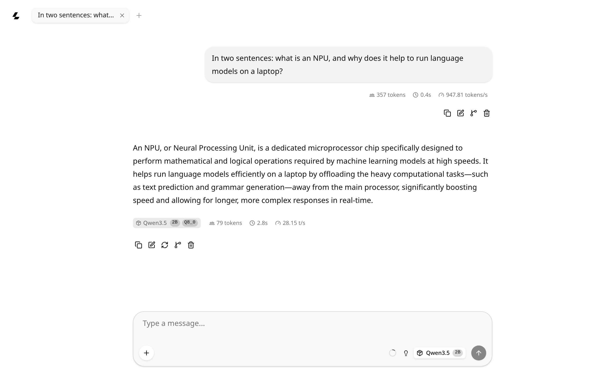

# llama.cpp-xdna

This README is also available in:\
[en-GB](doc/README.en-GB.md), en-US, [es-AR](doc/README.es-AR.md), [es-ES](doc/README.es-ES.md)

## What is it

A fork of [llama.cpp](https://github.com/ggml-org/llama.cpp) that runs GGUF language and speech-synthesis models on the NPU of AMD Ryzen AI processors (XDNA2), with a backend and NPU kernels written from scratch for it. The NPU reads the prompts and generates the text and speech, and the processor does what is left.

On a Ryzen AI 7 PRO 350 with Qwen3.5 4B (Q8_0), it reads a prompt about 15 times as fast as the processor alone (21 times on Qwen3.5 9B), and generates text about 40 % faster. Without an NPU it runs on the processor, alone or spread over several computers.

## Screenshots



## Install

Run it as `root`.

**Debian 13**:

```bash
curl -fsSL https://raw.githubusercontent.com/nipegun/llama.cpp-xdna/main/deploy/install-update-reinstall-debian.sh \
  | bash -s -- --install
```

**Alpine Linux** (3.21 or later):

```bash
wget -qO- https://raw.githubusercontent.com/nipegun/llama.cpp-xdna/main/deploy/install-update-reinstall-alpine.sh \
  | sh -s -- --install
```

## Read the documentation

Explore:

- [doc/MANUAL.md](doc/MANUAL.md) to learn what it needs, how to install it and how to use it with the NPU.
- [doc/CODE.md](doc/CODE.md) to understand how it is built (for developers and for AI models).
- [doc/XDNA2.md](doc/XDNA2.md), the technical notes on the NPU, with every measurement.

## Sponsor this project

- **[Hire me](mailto:nipegun@gmail.com?subject=I%20want%20to%20hire%20you%21)** to add new features.
- **GitHub Sponsors.** You can also support the project financially on GitHub: [github.com/sponsors/nipegun](https://github.com/sponsors/nipegun).
