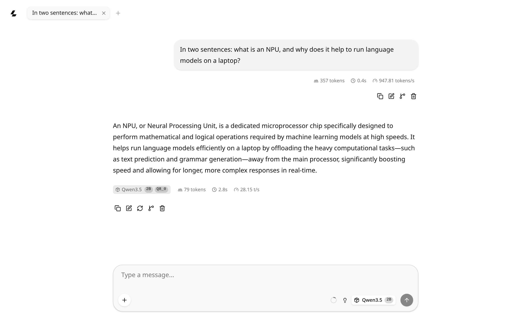

# llama.cpp-xdna

Este README también está disponible en:\
[en-GB](README.en-GB.md), [en-US](../README.md), [es-AR](README.es-AR.md), es-ES

## Qué es

Un fork de [llama.cpp](https://github.com/ggml-org/llama.cpp) que ejecuta modelos GGUF de lenguaje y de síntesis de voz en la NPU de los procesadores AMD Ryzen AI (XDNA2), con un backend y unos kernels para la NPU escritos desde cero para él. La NPU lee los prompts y genera el texto y la voz, y el procesador hace lo que queda.

En un Ryzen AI 7 PRO 350 con Qwen3.5 4B (Q8_0), lee un prompt unas 15 veces más rápido que el procesador solo (21 veces en Qwen3.5 9B) y genera texto aproximadamente un 40 % más rápido. Sin NPU funciona en el procesador, solo o repartido entre varios ordenadores.

## Capturas de pantalla



## Instalación

Como `root`.

**Debian 13**:

```bash
curl -fsSL https://raw.githubusercontent.com/nipegun/llama.cpp-xdna/main/deploy/install-update-reinstall-debian.sh \
  | bash -s -- --install
```

**Alpine Linux** (3.21 o posterior):

```bash
wget -qO- https://raw.githubusercontent.com/nipegun/llama.cpp-xdna/main/deploy/install-update-reinstall-alpine.sh \
  | sh -s -- --install
```

## Lee la documentación

Para saber más:

- [MANUAL.es-ES.md](MANUAL.es-ES.md): qué necesita, cómo se instala y cómo se usa con la NPU.
- [CODE.es-ES.md](CODE.es-ES.md): cómo está hecho (para desarrolladores y para modelos de inteligencia artificial).
- [XDNA2.md](XDNA2.md): las notas técnicas sobre la NPU, con todas las mediciones (en inglés).

## Patrocina este proyecto

- **[Contrátame](mailto:nipegun@gmail.com?subject=I%20want%20to%20hire%20you%21)** para añadir funcionalidades nuevas.
- **GitHub Sponsors.** También puedes apoyar económicamente el proyecto en GitHub: [github.com/sponsors/nipegun](https://github.com/sponsors/nipegun).
